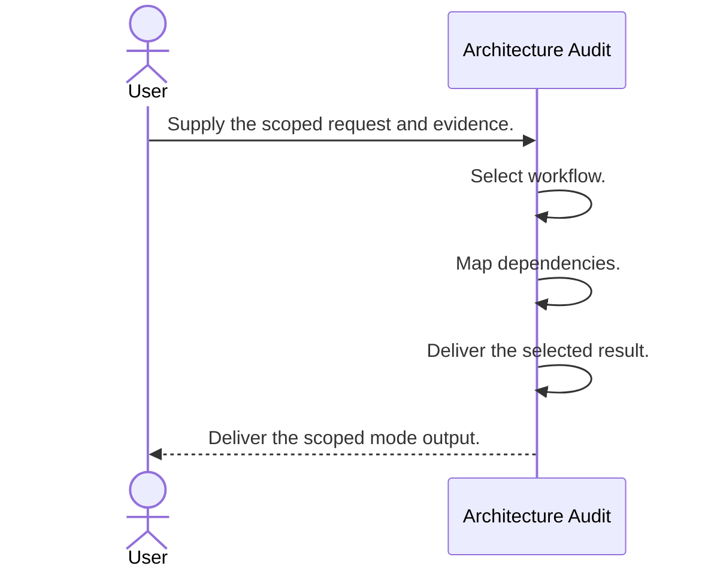
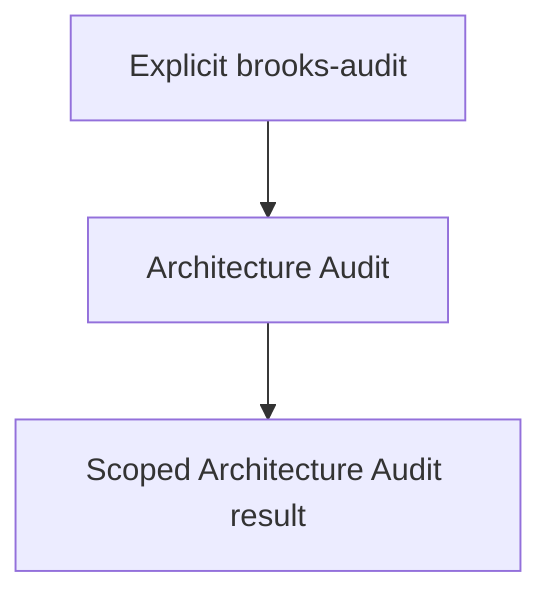

# Brooks Lint Architecture Audit Source Process

## Purpose

Map module responsibilities, dependency edges, and evidenced architectural decay. An explicit onboarding request selects an explanatory tour. Source entrypoint [SKILL-SOURCE.md](../src/brooks-audit/SKILL-SOURCE.md).

## File Inventory

| Source file | Category | Owner | Purpose |
| --- | --- | --- | --- |
| `SKILL-SOURCE.md` | Entrypoint | `brooks-audit` | Original manual trigger, setup, workflow, and mode output. |
| `agents/openai.yaml` | Agent policy | `brooks-audit` | Disables implicit invocation. |
| `architecture-guide.md` | Reference | `brooks-audit` | Executable procedure and mode output contract. |
| `onboarding-guide.md` | Reference | `brooks-audit` | Executable procedure and mode output contract. |

The copied `_shared` directory supplies project configuration, the report template, scoring, references, and optional custom risks and remedy details.

## Concepts

- **Module boundary.** The scope where source dependencies and runtime bindings are independently inspected.
- **Edge-and-change witness.** A dependency rule tied to a concrete substitution or coordination burden and a scoped remedy.

## High Level Process

A module, directory, or project, optionally constrained by an incremental ref. The onboarding intent chooses the tour workflow.



## Skill Call Graph

Onboarding is a branch of audit driven by the original prompt. Both guides remain bundled because non-interactive prompt assembly must include their supplied-file paths.



| Caller | Route | Callee | Condition |
| --- | --- | --- | --- |
| User or host | `brooks-audit` | Architecture Audit | Explicit invocation of the source mode. |

## Formal Skill Process

```python
@skill(name="brooks-audit", description="Architecture Audit")
def run(request):
    context = request
    context = agent_do("Select workflow.", context=context, constraints="Route an onboarding request to the tour. For diagnosis, establish the module boundary and evidence from manifests, imports, and composition.")
    context = agent_do("Map dependencies.", context=context, constraints="Draw the dependency graph using evidenced edges. Run risk checks, seam assessment, and ownership checks for diagnosis.")
    return agent_do("Deliver the selected result.", context=context, constraints="Apply severity colors after diagnosis and put the graph before findings. For a tour, use reading-order colors, conventions, danger zones, glossary, and first tasks.")
```

## Skill Process Explanation

- **Select workflow.** Route an onboarding request to the tour. For diagnosis, establish the module boundary and evidence from manifests, imports, and composition.
- **Map dependencies.** Draw the dependency graph using evidenced edges. Run risk checks, seam assessment, and ownership checks for diagnosis.
- **Deliver the selected result.** Apply severity colors after diagnosis and put the graph before findings. For a tour, use reading-order colors, conventions, danger zones, glossary, and first tasks.

Cycle evidence needs a closed path of the claimed edge type. Unknown ownership limits Conway findings. The tour carries reading-order guidance and omits diagnostic scoring and Iron Law findings.

## Evidence Handoffs

| Stage | Handoff | Consumer |
| --- | --- | --- |
| Select workflow | Tour intent or bounded module evidence | Map dependencies |
| Map dependencies | Graph, supported findings, and explicitly unassessed areas | Deliver the selected result |
| Deliver the selected result | Architecture Audit with Health Score where supported, or Codebase Tour | User or report consumer |
