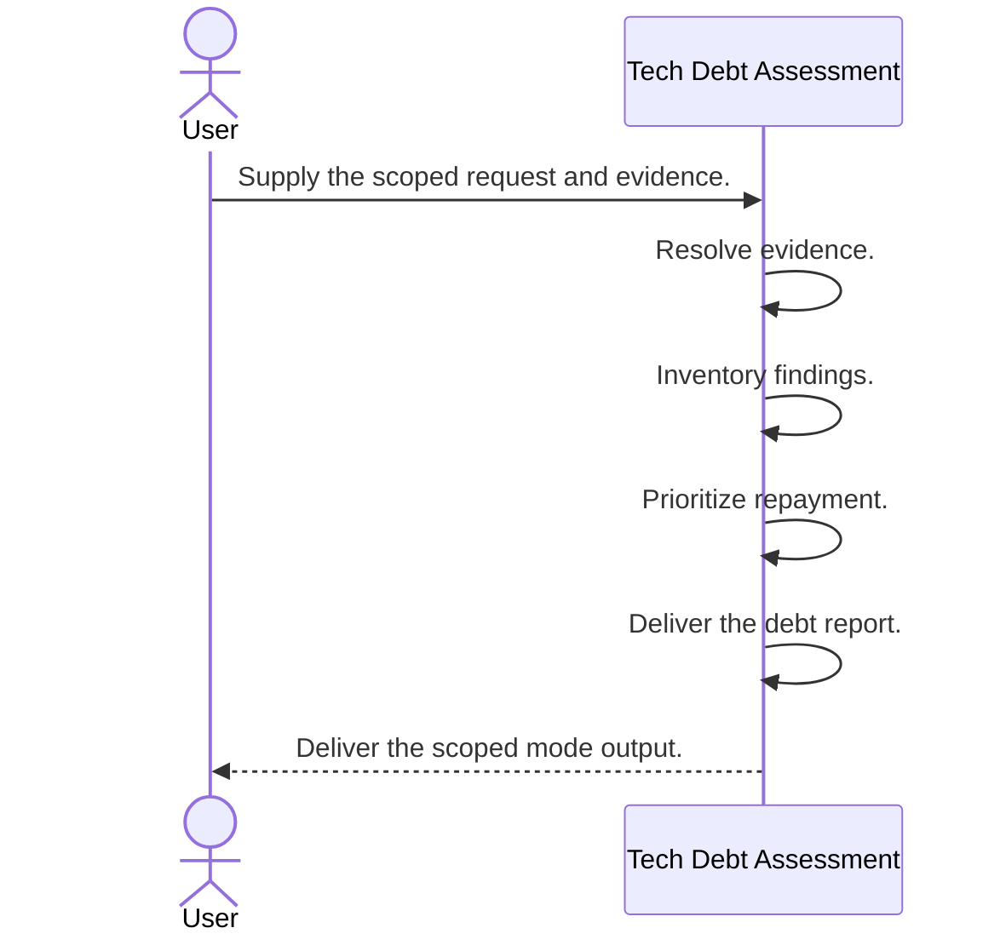
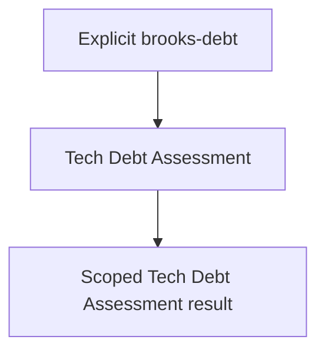

# Brooks Lint Tech Debt Assessment Source Process

## Purpose

Identify technical-debt findings, classify their evidenced intent, and prioritize repayment by observed change burden. Source entrypoint [SKILL-SOURCE.md](../src/brooks-debt/SKILL-SOURCE.md).

## File Inventory

| Source file | Category | Owner | Purpose |
| --- | --- | --- | --- |
| `SKILL-SOURCE.md` | Entrypoint | `brooks-debt` | Original manual trigger, setup, workflow, and mode output. |
| `agents/openai.yaml` | Agent policy | `brooks-debt` | Disables implicit invocation. |
| `debt-guide.md` | Reference | `brooks-debt` | Executable procedure and mode output contract. |

The copied `_shared` directory supplies project configuration, the report template, scoring, references, and optional custom risks and remedy details.

## Concepts

- **Pain × Spread.** Evidence-backed debt priority using 1–3 factors, bounded ranges when justified, and unknown when an essential fact is unavailable.
- **Intent.** Intentional, accidental, or unknown origin based on the supplied decision or history evidence.

## High Level Process

An explicit boundary, the whole project by default, or modules affected since the supplied ref. Ask one evidence question when needed and continue with available facts.



## Skill Call Graph

Uses shared risk definitions and report rules. The original workflow offers no separate mutating subcommand.



| Caller | Route | Callee | Condition |
| --- | --- | --- | --- |
| User or host | `brooks-debt` | Tech Debt Assessment | Explicit invocation of the source mode. |

## Formal Skill Process

```python
@skill(name="brooks-debt", description="Tech Debt Assessment")
def run(request):
    context = request
    context = agent_do("Resolve evidence.", context=context, constraints="Confirm the requested scope and identify unknowns that affect assessment.")
    context = agent_do("Inventory findings.", context=context, constraints="Apply all six production risks and capture the supported findings before scoring any of them.")
    context = agent_do("Prioritize repayment.", context=context, constraints="Assign observed pain and spread, retain ties or unknowns, and classify intent separately from severity.")
    return agent_do("Deliver the debt report.", context=context, constraints="Use the debt mode and summary table, count known priorities in the averages, and identify the smallest evidenced next action.")
```

## Skill Process Explanation

- **Resolve evidence.** Confirm the requested scope and identify unknowns that affect assessment.
- **Inventory findings.** Apply all six production risks and capture the supported findings before scoring any of them.
- **Prioritize repayment.** Assign observed pain and spread, retain ties or unknowns, and classify intent separately from severity.
- **Deliver the debt report.** Use the debt mode and summary table, count known priorities in the averages, and identify the smallest evidenced next action.

Unknown factors receive no guessed rank or deduction from an average. Use evidence of shared decision ownership and divergence before retaining a duplication finding. Severity follows its own evidence calibration.

## Evidence Handoffs

| Stage | Handoff | Consumer |
| --- | --- | --- |
| Resolve evidence | Scoped maintenance evidence and assessment limits | Inventory findings |
| Inventory findings | Finding inventory with causal witnesses | Prioritize repayment |
| Prioritize repayment | Prioritized and grouped finding inventory | Deliver the debt report |
| Deliver the debt report | Tech Debt Assessment, Health Score where supported, and Debt Summary | User or report consumer |
