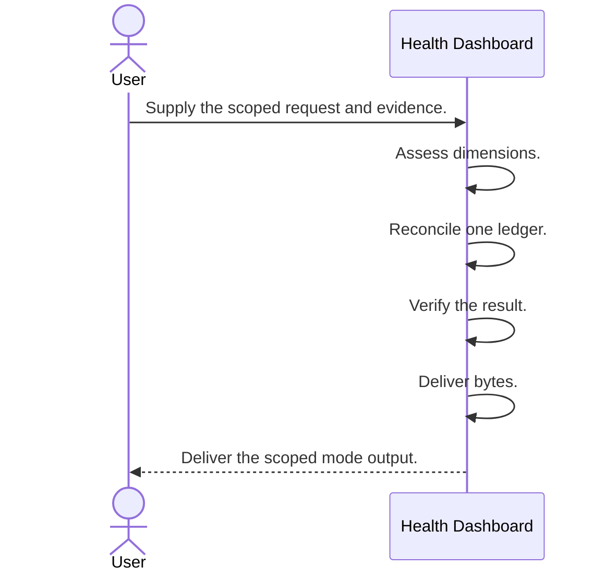
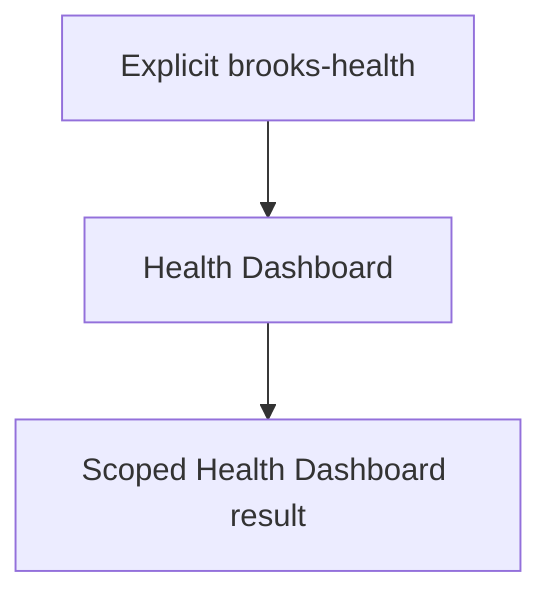

# Brooks Lint Health Dashboard Source Process

## Purpose

Summarize four quality dimensions at the requested scope with one reconciled score ledger and a verifiable output artifact when tools are available. Source entrypoint [SKILL-SOURCE.md](../src/brooks-health/SKILL-SOURCE.md).

## File Inventory

| Source file | Category | Owner | Purpose |
| --- | --- | --- | --- |
| `SKILL-SOURCE.md` | Entrypoint | `brooks-health` | Original manual trigger, setup, workflow, and mode output. |
| `agents/openai.yaml` | Agent policy | `brooks-health` | Disables implicit invocation. |
| `health-guide.md` | Reference | `brooks-health` | Executable procedure and mode output contract. |
| `score-ledger.md` | Reference | `brooks-health` | Executable procedure and mode output contract. |
| `scripts/score-dashboard.mjs` | Script | `brooks-health` | Validates and renders a ledger, finalizes a fresh report, and verifies the exact scored report. |
| `scripts/deliver-dashboard.mjs` | Script | `brooks-health` | Checks delivery against verified bytes and assembles an optional JSON envelope. |

The copied `_shared` directory supplies project configuration, the report template, scoring, references, and optional custom risks and remedy details.

## Concepts

- **Dimension status.** Assessed, unassessed with an evidence limit, or skipped for the PR dimension when there is no diff.
- **Verification receipt.** Hashes of the resolved ledger and final report used to prove the delivered artifact's bytes.
- **Scoring view.** Up to three independent findings per dimension and an additional per-risk cap of two for Debt.

## High Level Process

An explicit project scope or snapshot, its evidence inventory, optional diff, and applicable config. An explicitly supplied, adjudicated capped ledger can enter at scoring.



## Skill Call Graph

A host may run the bundled CLI, provide an equivalent exposed scorer, or accept the documented no-execution fallback. The delivery helper verifies the report separately.



| Caller | Route | Callee | Condition |
| --- | --- | --- | --- |
| User or host | `brooks-health` | Health Dashboard | Explicit invocation of the source mode. |

## Formal Skill Process

```python
@skill(name="brooks-health", description="Health Dashboard")
def run(request):
    context = request
    context = agent_do("Assess dimensions.", context=context, constraints="Build evidence maps and choose independent scoring owners. Preserve legitimate local conclusions alongside unknown broader scope.")
    context = agent_do("Reconcile one ledger.", context=context, constraints="Apply severity and finding caps. Cross-check draft findings and the scoring view in both directions.")
    context = agent_do("Verify the result.", context=context, constraints="Use the scorer and receipt when available and permitted. Use the prescribed text-only calculation only for a supported fallback.")
    return agent_do("Deliver bytes.", context=context, constraints="Return the checked artifact or embed its exact decoded report in the requested schema.")
```

## Skill Process Explanation

- **Assess dimensions.** Build evidence maps and choose independent scoring owners. Preserve legitimate local conclusions alongside unknown broader scope.
- **Reconcile one ledger.** Apply severity and finding caps. Cross-check draft findings and the scoring view in both directions.
- **Verify the result.** Use the scorer and receipt when available and permitted. Use the prescribed text-only calculation only for a supported fallback.
- **Deliver bytes.** Return the checked artifact or embed its exact decoded report in the requested schema.

An unassessed required dimension suppresses the composite. PR alone can be skipped and have its weight redistributed. A failed check never validates a numeric claim. A required tool workflow cannot be completed by arithmetic alone.

## Evidence Handoffs

| Stage | Handoff | Consumer |
| --- | --- | --- |
| Assess dimensions | Dimension statuses and uncapped evidence | Reconcile one ledger |
| Reconcile one ledger | Adjudicated ledger and score-free draft | Verify the result |
| Verify the result | Verified report or clearly limited output | Deliver bytes |
| Deliver bytes | Health Dashboard and Composite Score only when supported | User or report consumer |
