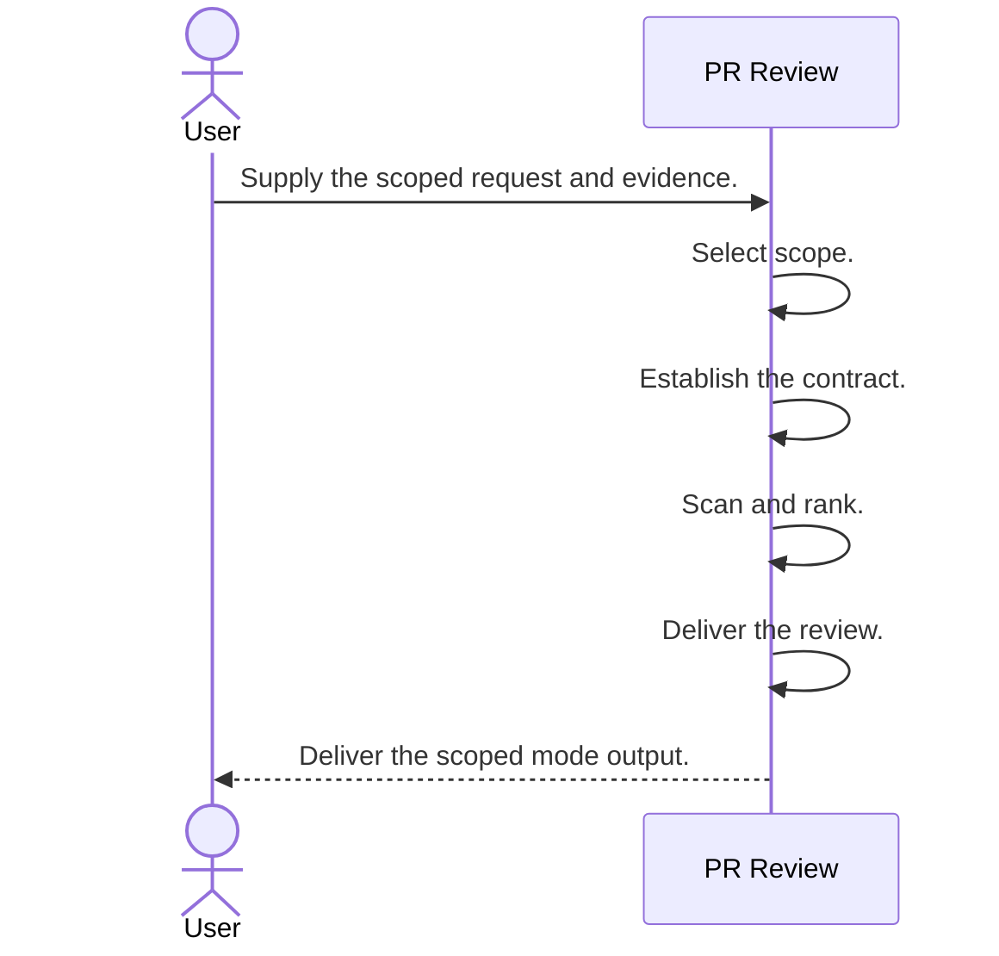
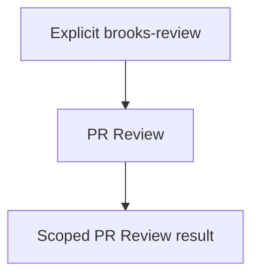

# Brooks Lint PR Review Source Process

## Purpose

Diagnose decay in a diff, pasted code, or explicitly selected files. Retain the governing contract and the evidence that distinguishes a finding from a plausible alternative. Source entrypoint [SKILL-SOURCE.md](../src/brooks-review/SKILL-SOURCE.md).

## File Inventory

| Source file | Category | Owner | Purpose |
| --- | --- | --- | --- |
| `SKILL-SOURCE.md` | Entrypoint | `brooks-review` | Original manual trigger, setup, workflow, and mode output. |
| `agents/openai.yaml` | Agent policy | `brooks-review` | Disables implicit invocation. |
| `pr-review-guide.md` | Reference | `brooks-review` | Executable procedure and mode output contract. |

The copied `_shared` directory supplies project configuration, the report template, scoring, references, and optional custom risks and remedy details.

## Concepts

- **Witness.** A permitted input and trace that show the governing outcome, the actual outcome, and a regression check.
- **Origin.** The base-to-change comparison that distinguishes introduced, worsened, and pre-existing behavior.

## High Level Process

The explicit code or path scope, or staged, working-tree, and branch diffs in that order. The project configuration applies when present.



## Skill Call Graph

The review may recommend a full test review for a systemic issue. Its own Quick Test Check executes inside review.



| Caller | Route | Callee | Condition |
| --- | --- | --- | --- |
| User or host | `brooks-review` | PR Review | Explicit invocation of the source mode. |

## Formal Skill Process

```python
@skill(name="brooks-review", description="PR Review")
def run(request):
    context = request
    context = agent_do("Select scope.", context=context, constraints="Identify the available inventory and record sampling or generated-file exclusions.")
    context = agent_do("Establish the contract.", context=context, constraints="Trace the caller obligation and a discriminating witness. Use the same witness on base and change when both exist.")
    context = agent_do("Scan and rank.", context=context, constraints="Run the ordered production-risk checks and the bounded Quick Test Check when production logic changes. Attach a separate test finding only for an independent consequence and remedy.")
    return agent_do("Deliver the review.", context=context, constraints="Use the PR Review report and keep the witness and executed or predicted label visible.")
```

## Skill Process Explanation

- **Select scope.** Identify the available inventory and record sampling or generated-file exclusions.
- **Establish the contract.** Trace the caller obligation and a discriminating witness. Use the same witness on base and change when both exist.
- **Scan and rank.** Run the ordered production-risk checks and the bounded Quick Test Check when production logic changes. Attach a separate test finding only for an independent consequence and remedy.
- **Deliver the review.** Use the PR Review report and keep the witness and executed or predicted label visible.

A plausible out-of-domain witness or unknown obligation stays unscored. Comparing against missing base evidence leaves origin unknown. Supply a short fix order when more than five findings are retained.

## Evidence Handoffs

| Stage | Handoff | Consumer |
| --- | --- | --- |
| Select scope | Reviewed files, boundaries, and limits | Establish the contract |
| Establish the contract | Supported defects, unresolved obligations, and origin evidence | Scan and rank |
| Scan and rank | Evidenced, severity-ranked findings | Deliver the review |
| Deliver the review | Mode, scope, Iron Law findings, and Health Score where supported | User or report consumer |
