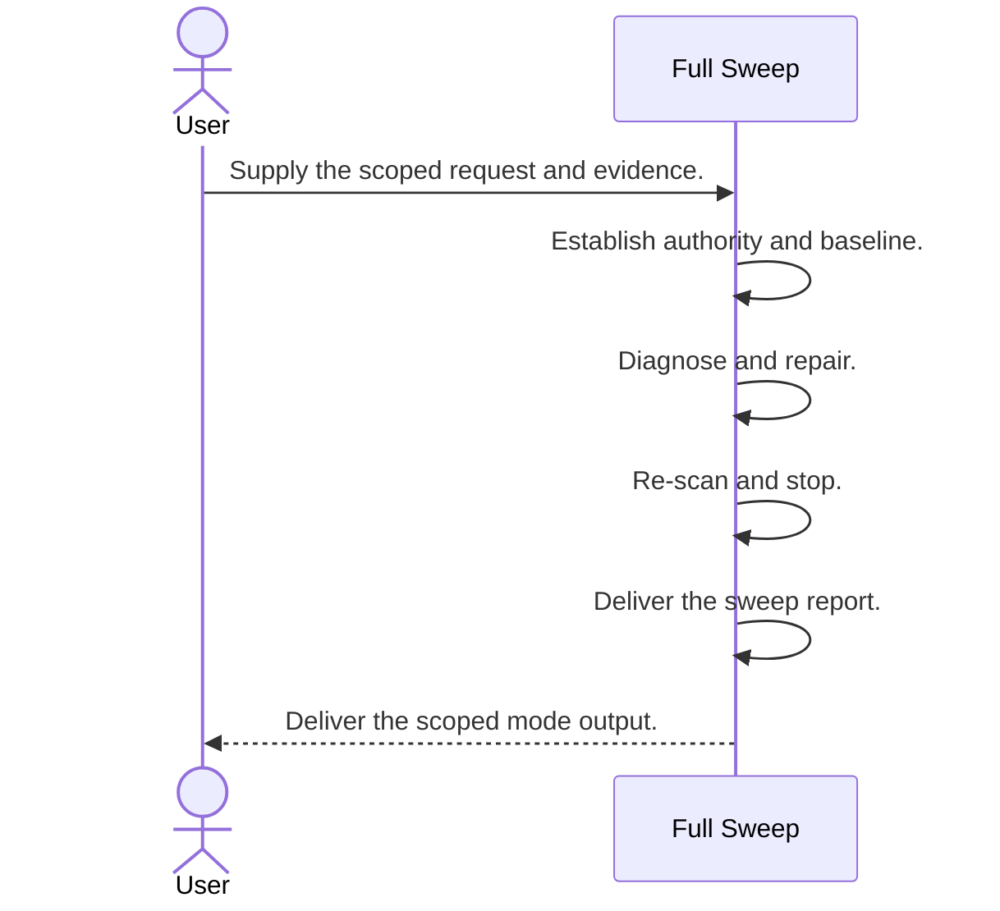
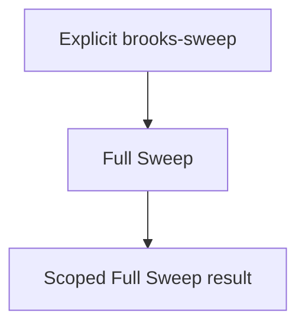

# Brooks Lint Full Sweep Source Process

## Purpose

Diagnose and perform only authorized scoped repairs through review, test, debt, and audit passes, then produce the health dashboard from the final verified source. Source entrypoint [SKILL-SOURCE.md](../src/brooks-sweep/SKILL-SOURCE.md).

## File Inventory

| Source file | Category | Owner | Purpose |
| --- | --- | --- | --- |
| `SKILL-SOURCE.md` | Entrypoint | `brooks-sweep` | Original manual trigger, setup, workflow, and mode output. |
| `agents/openai.yaml` | Agent policy | `brooks-sweep` | Disables implicit invocation. |
| `sweep-guide.md` | Reference | `brooks-sweep` | Executable procedure and mode output contract. |

The copied `_shared` directory supplies project configuration, the report template, scoring, references, and optional custom risks and remedy details.

## Concepts

- **Baseline.** Starting project and check state that separates prior failures and user edits from this sweep's patches.
- **Fix class.** Safe, Extended-Safe, or Residual based on boundary, contract, and verification evidence.
- **Stop reason.** The disposition of the requested work, resolved independently of broader dashboard completeness.

## High Level Process

Requested workspace or bounded replacement artifact, permitted paths, edit authority, evidence, and round, time, or tool limits.



## Skill Call Graph

The five passes use the focused guides as working references. Health finalizes output using the same capped view and exact delivery contract as the dedicated mode.



| Caller | Route | Callee | Condition |
| --- | --- | --- | --- |
| User or host | `brooks-sweep` | Full Sweep | Explicit invocation of the source mode. |

## Formal Skill Process

```python
@skill(name="brooks-sweep", description="Full Sweep")
def run(request):
    context = request
    context = agent_do("Establish authority and baseline.", context=context, constraints="Reuse existing permission, record project config, user changes, and relevant checks. Separate the repair scope from broader dashboard coverage.")
    context = agent_do("Diagnose and repair.", context=context, constraints="Run review, test, debt, and audit guide passes using one deduplicated finding ledger. Classify, apply only supported authorized repairs, and check them.")
    context = agent_do("Re-scan and stop.", context=context, constraints="Re-check modified files, affected module files, and consumers. Reverse only the sweep's patches on attributable regression and choose the supported stop reason.")
    return agent_do("Deliver the sweep report.", context=context, constraints="Perform the final health pass using revalidated evidence and its scoring view. Preserve a requested structured result and exact verified report.")
```

## Skill Process Explanation

- **Establish authority and baseline.** Reuse existing permission, record project config, user changes, and relevant checks. Separate the repair scope from broader dashboard coverage.
- **Diagnose and repair.** Run review, test, debt, and audit guide passes using one deduplicated finding ledger. Classify, apply only supported authorized repairs, and check them.
- **Re-scan and stop.** Re-check modified files, affected module files, and consumers. Reverse only the sweep's patches on attributable regression and choose the supported stop reason.
- **Deliver the sweep report.** Perform the final health pass using revalidated evidence and its scoring view. Preserve a requested structured result and exact verified report.

A default cap of three counts all rounds. Unsupported repair authority or verification keeps a change out of the applied set. Retire a single causal finding after three failures. Missing wider dashboard evidence can suppress the composite independently of a successful local stop.

## Evidence Handoffs

| Stage | Handoff | Consumer |
| --- | --- | --- |
| Establish authority and baseline | Permitted scope, baseline, and bounded plan | Diagnose and repair |
| Diagnose and repair | Finding ledger, fix log, and verification evidence | Re-scan and stop |
| Re-scan and stop | Verified final source, residuals, and disposition | Deliver the sweep report |
| Deliver the sweep report | Full Sweep with iteration history, fix log, residuals, and one final dashboard | User or report consumer |
