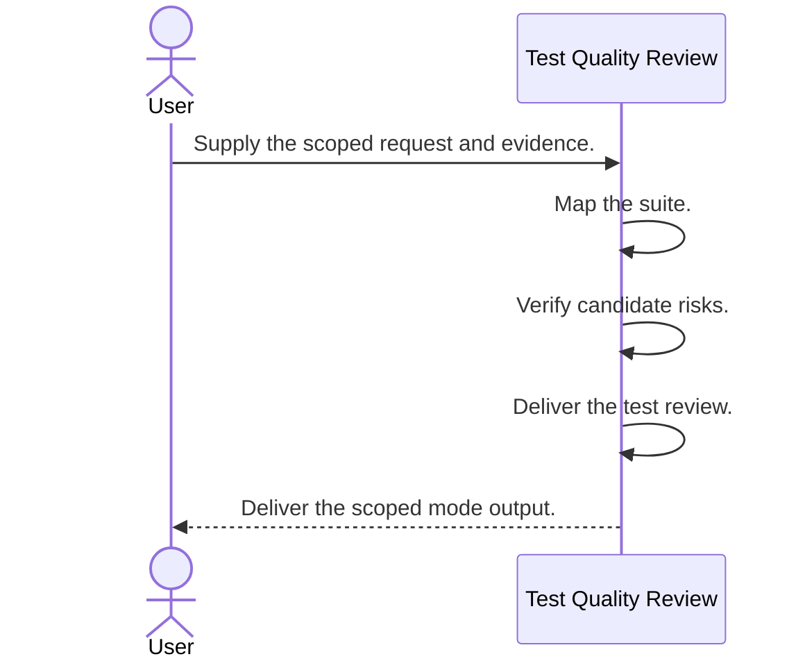
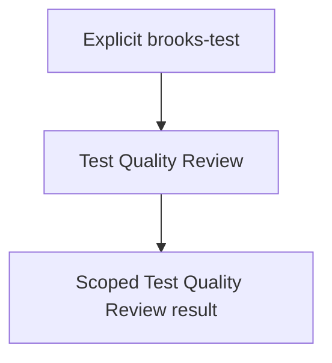

# Brooks Lint Test Quality Review Source Process

## Purpose

Assess the observed suite and demonstrate the actual interpretability, maintenance, or protection consequence for each retained test finding. Source entrypoint [SKILL-SOURCE.md](../src/brooks-test/SKILL-SOURCE.md).

## File Inventory

| Source file | Category | Owner | Purpose |
| --- | --- | --- | --- |
| `SKILL-SOURCE.md` | Entrypoint | `brooks-test` | Original manual trigger, setup, workflow, and mode output. |
| `agents/openai.yaml` | Agent policy | `brooks-test` | Disables implicit invocation. |
| `test-guide.md` | Reference | `brooks-test` | Executable procedure and mode output contract. |

The copied `_shared` directory supplies project configuration, the report template, scoring, references, and optional custom risks and remedy details.

## Concepts

- **Suite map.** Observed files, test categories, approximate counts, protected modules, and known execution limits.
- **Discrimination witness.** A comparison showing why the actual assertion accepts a faulty change, rejects an equivalent change, or fails to surface an injected assertion failure.

## High Level Process

An existing test suite or excerpt, its governing production scope, and available runtime evidence. When inferred, prioritize tests associated with changed production files.



## Skill Call Graph

Uses shared test risk and scoring references. Its evidence labels carry through to a sweep pass.



| Caller | Route | Callee | Condition |
| --- | --- | --- | --- |
| User or host | `brooks-test` | Test Quality Review | Explicit invocation of the source mode. |

## Formal Skill Process

```python
@skill(name="brooks-test", description="Test Quality Review")
def run(request):
    context = request
    context = agent_do("Map the suite.", context=context, constraints="Read test bodies and the relevant production contract, labeling excerpts and unanswered blockers.")
    context = agent_do("Verify candidate risks.", context=context, constraints="Compare relevant variants and assertions and distinguish protection, brittleness, and failure propagation evidence.")
    return agent_do("Deliver the test review.", context=context, constraints="Apply the Iron Law and place the Test Suite Map before Findings.")
```

## Skill Process Explanation

- **Map the suite.** Read test bodies and the relevant production contract, labeling excerpts and unanswered blockers.
- **Verify candidate risks.** Compare relevant variants and assertions and distinguish protection, brittleness, and failure propagation evidence.
- **Deliver the test review.** Apply the Iron Law and place the Test Suite Map before Findings.

A gap requires an established obligation and relevant inventory. Missing source supports at most a focused question and a coverage limit. Distinct useful checks may coexist even when they look alike.

## Evidence Handoffs

| Stage | Handoff | Consumer |
| --- | --- | --- |
| Map the suite | Suite map with observed inventory | Verify candidate risks |
| Verify candidate risks | Scoped test witnesses with executed or predicted outcomes | Deliver the test review |
| Deliver the test review | Test Quality Review, T-series findings, and Health Score where supported | User or report consumer |
